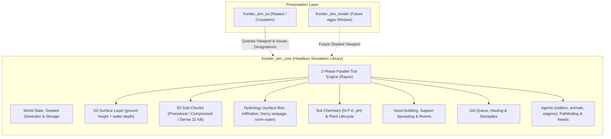
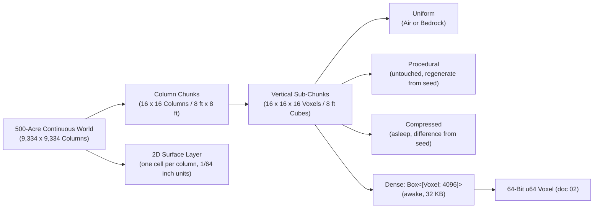
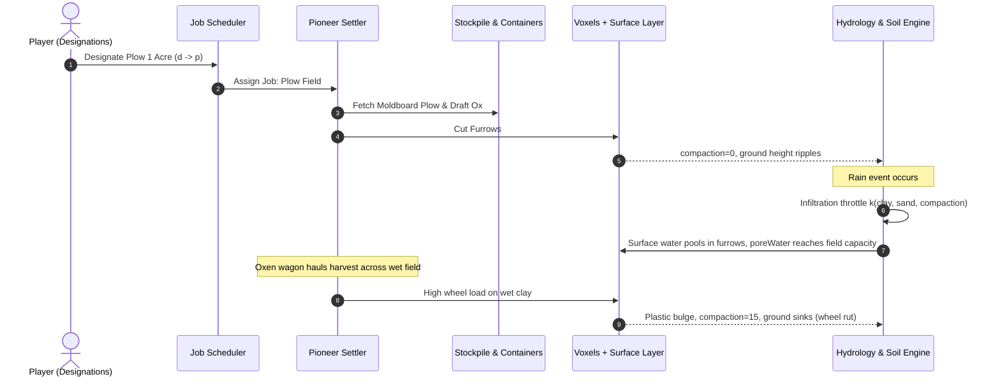

# Frontier Farming Simulator — Architecture Review & Design Summary

> **Note:** This is an overview and risk list for the design in `docs/01` through `docs/14`. It does not repeat the voxel bit layout. Doc 02 is the single source of truth for that.

---

## 1. System Architecture & Crate Pipeline

The project is a Rust workspace. The simulation is a headless library with no UI code, so it can be tested on its own.

---

## 2. Spatial Hierarchy

* **Voxel:** 64 bits. Soil texture, compaction, pore water, N-P-K, pH, temperature band, a 16-bit `entityRef`, and 8 flags. Surface water and micro-relief are not in the voxel.
* **Surface layer:** exact ground height and surface water depth per column, in fine units, so gentle slopes and deep water both work.
* **Cache:** a dense sub-chunk is 32 KB. That fits in L1 on some CPUs and in L2 on all current desktop CPUs. It gives good locality, not zero cache misses.

---

## 3. Physical Loops & System Interactions

---

## 4. Risks, Bottlenecks & Mitigations

### Risk 1: Time Scale and CPU Budget (OPEN, most important)
Every CPU number depends on how much game time passes per real second. The working assumption is a 20-minute game day at 1x speed and short 12-day seasons, with night handling as a player setting (doc 06). Real-speed water physics at that pace is far too expensive.

* **Mitigation:** Surface water runs on a slowed, stable step of about one game minute (doc 03). Subsurface water and heat run hourly. Crops run daily.
* **Still to do:** Measure real costs in milestone M3 and tune the day length.

### Risk 2: Rain Wakes the Whole Claim (MITIGATED)
Rain falls everywhere at once, so treating it as a 3D voxel event would wake every chunk in the claim.

* **Mitigation:** Rain goes into the 2D surface layer, one cell per column instead of about 26 voxels. Tiles only run the flow step where rain falls faster than the soil absorbs it (doc 03, section 3.1).

### Risk 3: Water Getting Stuck on Gentle Slopes (MITIGATED)
4-bit water and height values in $0.375\text{"}$ steps cannot represent a 1% field slope. Water would sit on flat terraces or jitter.

* **Mitigation:** Ground height and water depth are integers in $1/64\text{"}$ units in the surface layer.

### Risk 4: Pathfinding on a 6-Inch Grid (OPEN)
A path across $500\text{ ft}$ spans 1,000 voxels and expands tens of thousands of search nodes.

* **Mitigation (two-level pathfinding):**
  1. **Macro level ($8\text{ ft}$ chunk grid):** Long trips use a coarse graph of connected chunk portals (roads, pastures, gates). If two areas are not connected, the query fails right away.
  2. **Micro level ($6\text{"}$ grid):** Local steering (stepping over a furrow, going through a door) runs only near the agent.
* **Agent size:** A person is about $18\text{"}$ wide, an ox about $3\text{ ft}$, a wagon $5\text{–}6\text{ ft}$. Both levels use a clearance map so each size class only goes where it fits (doc 01).

### Risk 5: Entities per Sub-Chunk (RESOLVED)
An 8-bit `entityRef` allowed only 255 entities per sub-chunk, which one crop field could exceed. Moving surface water out of the voxel freed 8 bits, so `entityRef` is now 16 bits.

* **Still open:** Whether each crop plant is an entity record at all. A 40-acre field is millions of plants (doc 09, open questions).

### Risk 6: Race Conditions at Chunk Borders (RESOLVED)
* Every cell's outflow is clamped to the water it holds ($\sum \text{out} \le \text{depth}$).
* Flow crossing a border is written to an edge buffer and added up by the receiving tile or sub-chunk in the next phase.
* All math is fixed-point integer, and each unit reads only its own data plus read-only snapshots, so results are the same with any thread count.
* Flow uses 4 neighbors, which spreads water in slightly diamond-shaped patterns. That is acceptable.

### Risk 7: Stockpile Search Cost (OPEN)
If 20 settlers scan 5,000 stockpile voxels for items every tick, the job search grows as $O(N \times M)$.

* **Mitigation (item lookup buckets):**
  * Settlers never scan voxels to find items.
  * The `itemTable` keeps availability buckets by `item_type` and `material_id`, also grouped by area, so "nearest unreserved pine log" is a fast lookup instead of a scan.

---

## 5. Design Status

| System | Doc | Status | Next Step |
| :--- | :---: | :--- | :--- |
| **Voxel Layout & Storage** | 02 | Specified | Measure memory and compression in M1 to M3 |
| **Hydrology & Surface Layer** | 03 | Specified | Prove conservation and drainage on a test map (M2) |
| **Voxel Building & Support** | 04 | Specified | Prototype support spreading and rooms (M7) |
| **Plants & Farming** | 05 | Partly specified | Decide crop storage (open question) |
| **Sim Engine & Time Scale** | 06 | Working assumptions | Tune day length and tick budget (M3) |
| **Camera & UI** | 07 | Specified | Build the viewer (M1) |
| **Stockpiles & Logistics** | 08 | Partly specified | Needs settler AI design |
| **Settler AI, Jobs & Needs** | 13 | Specified | Build one settler and area jobs (M7) |
| **Weather & Climate** | 11 | Specified | Simple fixed weather for M2 to M6; full generator in M9 |
| **World Generation** | 10 | Specified | Build the coarse map and detail stage (M1) |
| **Save & Load** | 02, 12 | Specified | Build and measure save size (M4) |
| **Animals** | 14 | Specified | Oxen and the plow rig (M7); the rest in M10+ |
| **Fire, Town Economy** | 01 (overview) | Not written | Later milestones |
